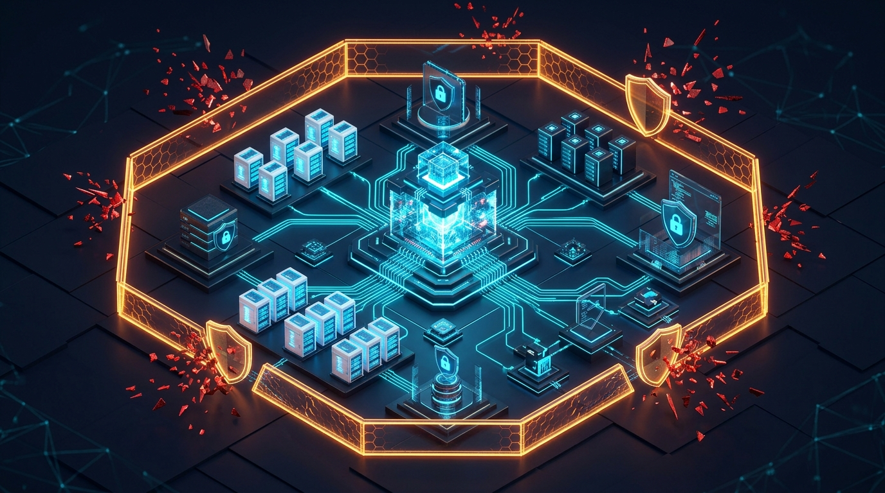

# The Rise of Autonomous AI Agent Cyberattacks

As organizations rapidly integrate autonomous AI agents to manage enterprise infrastructure, software deployment, and corporate data pipelines, threat actors have begun exploiting architectural vulnerabilities unique to agentic systems. From indirect prompt injection and unauthorized tool execution to persistent memory poisoning, these attacks allow adversaries to hijack autonomous agents as internal insider threats.

Our latest security report examines emerging real-world AI agent attack vectors, threat modeling frameworks, and vital guardrails for securing agentic workflows.

Read the full technical breakdown on our official security portal: [Autonomous AI Agent Cyberattacks](https://cyberupdates365.com/ai-agent-cyberattacks/)
